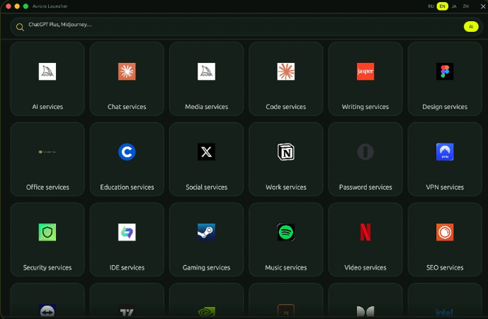

# Proton VPN Plus Free 2026 — Secure Core on Windows

> **Proton VPN is paid everywhere. In our Aivora launcher the same paid Plus version is free.**
>
> Official site / app store = paid Plus subscription. Aivora launcher = that paid Plus product, free on Windows 10 / 11.

**Keywords:** Proton VPN · ProtonVPN vpn free · ProtonVPN vpn windows · Secure Core · Swiss VPN · paid Proton VPN free through launcher · Aivora Programs

Windows 10 / 11 · Proton VPN Plus · VPN services

The orange button opens [https://aivoraprograms.com/](https://aivoraprograms.com/). Install Aivora, then **Activate** **Proton VPN**. You get the **paid Plus** product **for free in our launcher**. No `ProtonVPN.exe` in this repository.

## What Proton VPN is

Proton VPN Plus is Proton’s paid Swiss tunnel. The Aivora card is **Plus** with **Secure Core**: traffic enters a Proton-owned hop in a privacy-friendly country before the exit. Open-source clients, Swiss law. This is not Proton Mail and not Proton Calendar.

**Proton VPN is paid everywhere else.** Official access is a Plus subscription. In **our Aivora launcher** that same paid Plus is **free** on Windows 10 / 11. No vendor account. No credit card.

## Secure Core on Windows

Secure Core is a two-hop inside Proton’s own network, not Nord’s Double VPN branding. Use it when the exit country is noisy. For speed, pick a direct Plus server after **Activate**. Open-source here means you can read the client; it does not mean the Aivora repo ships source.

## Who this Windows page is for

Searches **Proton VPN**, **ProtonVPN vpn windows**, **ProtonVPN vpn free** wanting **paid Plus** / Secure Core, not the official free Proton VPN servers.

## What the Plus card includes

| Feature | Official Proton VPN | In our Aivora launcher |
|---------|--------------|------------------------|
| Price | Paid Plus subscription | **Free** (same paid Plus) |
| **Secure Core** | Plus | Same paid Plus, free here |
| **Swiss jurisdiction** | Plus | Same paid Plus, free here |
| **Open-source client** | Plus | Same paid Plus, free here |
| **Windows 10 / 11** | Plus | Same paid Plus, free here |

## How to open paid Proton VPN on Windows

1. Open [https://aivoraprograms.com/](https://aivoraprograms.com/)
2. Download **Aivora Launcher**
3. Install on **Windows 10** or **Windows 11** (64-bit)
4. Open **VPN services**
5. Find **Proton VPN** and press **Activate**

Paid Proton VPN Plus — **free in our launcher**, paid on the official site.

## Search queries this page covers

- **Proton VPN**
- **ProtonVPN vpn free**
- **ProtonVPN vpn windows**
- **Secure Core**
- **paid Proton VPN free through launcher**

## Screenshots

Aivora launcher hub — **VPN services** → **Proton VPN**:

## FAQ

**Is this the free Proton VPN?**  
No. Official free is a limited SKU. This landing is paid Plus, free in our launcher.

**Where is the download?**  
[https://aivoraprograms.com/](https://aivoraprograms.com/)

**Is Proton VPN paid or free?**  
Paid everywhere (official Plus). **Free in our Aivora launcher** — same paid Plus version.

**Do I need a Proton VPN account?**  
No. **Activate** on the tile.

---

## На русском

# Proton VPN Plus бесплатно 2026 — Secure Core на Windows

> **Везде Proton VPN платный. В нашем лаунчере Aivora та же платная версия Plus — бесплатно.**
>
> Официальный сайт / магазин = платная подписка Plus. Лаунчер Aivora = этот же платный Plus, бесплатно на Windows 10 / 11.

**Ключевые слова:** Proton VPN · ProtonVPN vpn бесплатно · ProtonVPN vpn windows · Secure Core · платный Proton VPN бесплатно через лаунчер · Aivora Programs

Оранжевая кнопка — главная Aivora. Лаунчер → **VPN-сервисы** → **Proton VPN** → **Активировать**. Это **платный Plus**, у нас в лаунчере **бесплатно**.

Proton VPN Plus — платный швейцарский VPN. На карточке Aivora **Plus** и **Secure Core**: сначала hop Proton, потом выход. Это не Mail и не Calendar.

**Proton VPN везде платный.** Официально подписка Plus. **В нашем лаунчере Aivora** та же платная Plus-версия — **бесплатно** на Windows 10 / 11.

Secure Core — два hop внутри сети Proton, не бренд Double VPN. Для скорости бери прямой Plus-сервер после активации.

Запросы **Proton VPN**, **vpn windows**, **vpn бесплатно** — нужен **платный Plus**, не официальный free Proton VPN.

| Функция | Официально | В нашем лаунчере Aivora |
|---------|------------|-------------------------|
| Цена | Платная подписка Plus | **Бесплатно** (тот же Plus) |
| **Secure Core** | Plus | Та же платная Plus, у нас бесплатно |
| **Юрисдикция Швейцарии** | Plus | Та же платная Plus, у нас бесплатно |
| **Открытый клиент** | Plus | Та же платная Plus, у нас бесплатно |
| **Windows 10 / 11** | Plus | Та же платная Plus, у нас бесплатно |

Как открыть: [https://aivoraprograms.com/](https://aivoraprograms.com/) → лаунчер → **VPN-сервисы** → **Proton VPN** → **Активировать**.

**Это бесплатный Proton VPN?**  
Нет. Официальный free урезан. Здесь платный Plus, у нас бесплатно.

Proton VPN — товарный знак Proton AG. Страница описывает доступ через Aivora Programs.

[https://aivoraprograms.com](https://aivoraprograms.com/) · hello@aivora.app

#windows11 #windows10 #vpn #protonvpn #aivora

---

*Proton VPN · ProtonVPN vpn free · ProtonVPN vpn windows · Secure Core · Swiss VPN · paid Proton VPN free through launcher · Aivora Programs · paid Proton VPN free through launcher · Aivora Programs · https://aivoraprograms.com/programs/protonvpn/*
